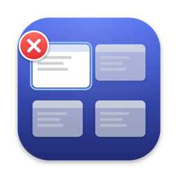
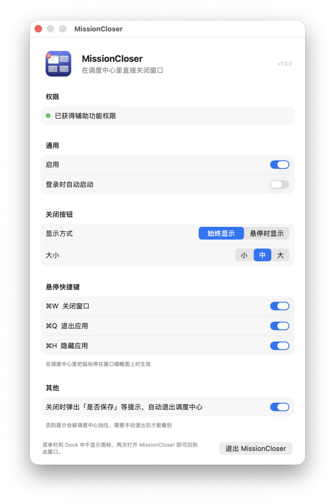

<p align="center">
  
</p>

<h1 align="center">MissionCloser</h1>

<p align="center">
  在 macOS 调度中心（Mission Control）里直接关闭窗口<br>
  <sub>Close windows right from macOS Mission Control.</sub>
</p>

<p align="center">
  <a href="https://github.com/ggllzz04/MissionCloser/releases/latest"></a>
  
  
  <a href="LICENSE"></a>
</p>

---

macOS 的调度中心可以看到所有窗口，却不能直接关掉它们。MissionCloser 补上了这一点：

- **ⓧ 关闭按钮**：每个窗口缩略图左上角都有关闭按钮，鼠标悬停时变红
- **悬停快捷键**：鼠标停在缩略图上时
  - `⌘W` 关闭该窗口
  - `⌘Q` 退出该应用
  - `⌘H` 隐藏该应用
- **不打断调度中心**：关闭窗口后调度中心保持打开，可以连续清理多个窗口
- **安全处理未保存内容**：关闭时如果弹出「是否保存」，会自动退出调度中心，让你看到并处理提示
- **安静地在后台运行**：菜单栏和 Dock 里都不显示图标；再次打开应用即可进入设置
- 体积小，无任何依赖，原生 Swift 编写，同时支持 Apple Silicon 和 Intel

<p align="center">
  
</p>

## 安装

1. 从 [Releases](https://github.com/ggllzz04/MissionCloser/releases/latest) 下载 `MissionCloser.zip`，解压后把 `MissionCloser.app` 拖进「应用程序」文件夹
2. 首次打开：应用没有经过 Apple 公证，需要**右键点击 → 打开**，在弹窗中再点一次「打开」。
   如果系统提示「已损坏」或无法打开，在终端执行：
   ```bash
   xattr -dr com.apple.quarantine /Applications/MissionCloser.app
   ```
3. 按提示在 **系统设置 › 隐私与安全性 › 辅助功能** 中打开 MissionCloser。授权后立即生效，不用重启应用
4. 在设置窗口里打开「登录时自动启动」，以后开机就会自动在后台运行

## 使用

打开调度中心（触控板三指上滑、`⌃↑` 或 F3），然后：

| 操作 | 效果 |
| --- | --- |
| 点击缩略图左上角的 ⓧ | 关闭该窗口 |
| 悬停在缩略图上按 `⌘W` | 关闭该窗口 |
| 悬停在缩略图上按 `⌘Q` | 退出该应用 |
| 悬停在缩略图上按 `⌘H` | 隐藏该应用 |

关掉的窗口在调度中心里会留下一个空白占位框，这是系统本身的行为，退出调度中心后布局就会恢复正常。

### 设置

MissionCloser 不在菜单栏和 Dock 中显示图标。需要调整设置时，**再打开一次 MissionCloser**（从「应用程序」、启动台或 Spotlight 都可以），就会弹出设置窗口：

| 设置项 | 说明 |
| --- | --- |
| 启用 | 临时停用时不需要退出应用 |
| 登录时自动启动 | 开机后自动在后台运行，不弹窗 |
| 关闭按钮显示方式 | 始终显示 / 仅在鼠标悬停的缩略图上显示 |
| 关闭按钮大小 | 小 / 中 / 大 |
| 悬停快捷键 | `⌘W`、`⌘Q`、`⌘H` 可以分别开关 |
| 弹出保存提示时自动退出调度中心 | 关闭后提示会被调度中心挡住，需要手动退出才能看到 |

设置窗口底部有「退出 MissionCloser」按钮。

## 从源码构建

只需要 Xcode Command Line Tools（`xcode-select --install`），不需要完整的 Xcode：

```bash
git clone https://github.com/ggllzz04/MissionCloser.git
cd MissionCloser
scripts/build.sh          # 生成 build/MissionCloser.app
scripts/build.sh --zip    # 额外生成 build/MissionCloser.zip
```

构建出来的是本地临时签名的应用。**每次重新构建后签名都会变化**，需要到「辅助功能」列表里删掉旧的 MissionCloser 条目（选中后点 −），再重新授权一次。

调试时可以直接运行可执行文件，控制台会打印每个缩略图匹配到的窗口以及每次操作：

```bash
MISSIONCLOSER_DEBUG=1 build/MissionCloser.app/Contents/MacOS/MissionCloser
```

### 项目结构

```
Sources/
  main.swift            入口、启动逻辑（登录项启动时静默运行，否则弹出设置）
  Controller.swift      检测调度中心、摆放按钮、处理点击和快捷键
  MissionControl.swift  读取调度中心缩略图，匹配回真实窗口，关闭窗口
  CloseButton.swift     关闭按钮的绘制与悬浮面板
  Settings.swift        设置项与 SwiftUI 设置窗口
Resources/              Info.plist、应用图标
scripts/
  build.sh              构建脚本
  make-icon.swift       用代码绘制应用图标
```

## 工作原理

1. **识别缩略图**：调度中心由 Dock 进程绘制。它激活时，Dock 的辅助功能树里会出现
   `AXGroup(mc) → AXGroup(mc.display) → AXGroup(mc.windows) → AXButton`，
   每个 `AXButton` 就是一个窗口缩略图，带有标题和屏幕坐标
2. **匹配真实窗口**：缩略图本身不带所属进程，所以用「标题 + 宽高比 + 在屏幕上的相对位置」把它对应回各应用的窗口
3. **显示按钮**：在高于调度中心的窗口层级上放置透明的小面板来绘制 ⓧ
4. **拦截点击**：调度中心激活时，Dock 会拿走所有鼠标事件，普通窗口收不到点击。所以点击和快捷键都通过 `CGEventTap` 在系统层面拦截：按钮区域内的点击会被吞掉并执行关闭，其余事件照常交给调度中心
5. **关闭窗口**：优先按窗口自带的关闭按钮。如果窗口没有关闭按钮或按了没反应，就临时激活该应用（不会退出调度中心），给目标窗口发送 `⌘W`，然后切回原来的前台应用

整个过程只用到公开的辅助功能 API，不需要关闭 SIP，也不注入 Dock。

## 已知限制

- 关掉的窗口在调度中心里会留下空白占位框，退出后才会重新排布（系统行为）
- 如果多个窗口的标题完全相同、尺寸也几乎一样，可能会对应错窗口
- 只处理当前桌面空间里的窗口缩略图
- 在 macOS 26 上开发和测试，理论上支持 macOS 13 及以上。不同系统版本的调度中心结构可能有差异，遇到问题欢迎提 Issue

## 卸载

1. 打开 MissionCloser，在设置窗口里关闭「登录时自动启动」，然后点「退出 MissionCloser」
2. 把 `/Applications/MissionCloser.app` 移到废纸篓
3. 在 **系统设置 › 隐私与安全性 › 辅助功能** 中删除 MissionCloser 条目

## 致谢

灵感来自 [Mission Control Plus](https://www.fadel.io/missioncontrolplus)。本项目是独立实现的开源替代，与其没有任何关联。

## License

[MIT](LICENSE)
